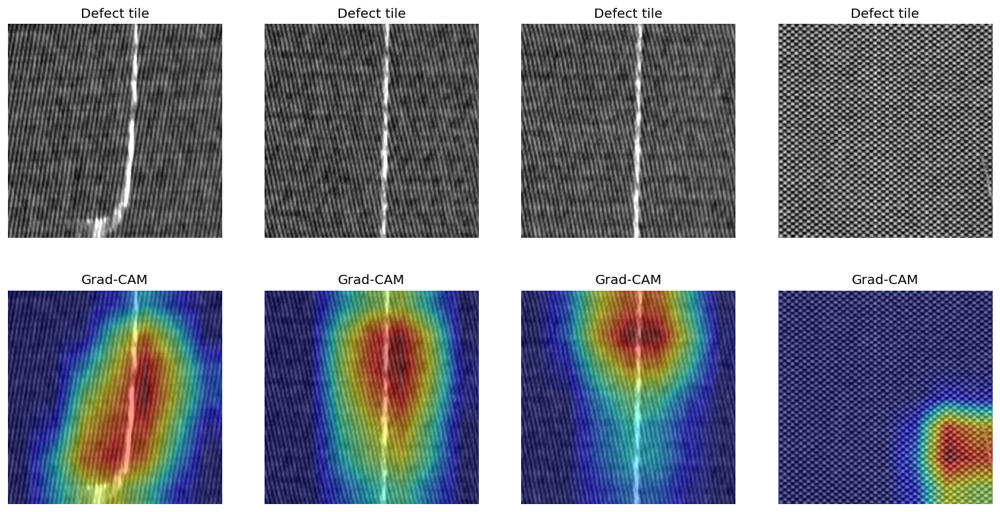

# Fabric Defect Detection using Deep Learning

Can a camera spot defects in woven fabric as reliably as a trained inspector? This project
fine-tunes a **ResNet18 CNN** on real textile scans to flag defective fabric, and uses
**Grad-CAM** to show *where* each defect is.

**Tools:** Python, PyTorch, torchvision, OpenCV, scikit-learn
**Data:** [AITEX Fabric Image Database](https://www.aitex.es/afid/): 247 grayscale fabric scans
(4096 × 256 px): 106 with defects plus pixel-level defect masks, and 141 defect-free. Not included in
this repo; download it and place the folders in `data/`.


*Red = where the model looks when it predicts "defect". It lands on the defect every time.*

---

## Key results (test set, unseen fabric scans)

| Model | ROC-AUC | Precision (defect) | Recall (defect) | False alarms |
|---|---|---|---|---|
| ResNet18, frozen | 0.64 | 0.096 | 0.535 | 216 |
| **ResNet18, fine-tuned** | **0.962** | **0.818** | 0.628 | **6** |
| Fine-tuned, threshold 0.2 | 0.962 | 0.567 | **0.791** | 26 |

Fine-tuning lifted ROC-AUC from **0.64 to 0.96** and cut false alarms from **216 to 6**.
Lowering the decision threshold to 0.2 raised defect recall to **79%**, the right trade-off for
quality control, where a missed defect costs far more than a 10-second manual check.

## Approach

1. **Tiling:** each 4096-px-wide scan is cut into 256 × 256 tiles (**3,552 tiles**). A tile is
   labelled *defect* if its region of the mask contains any defect pixels. Blank scanner regions
   (mean brightness > 240) and partial edge tiles are skipped.
2. **Leakage-free split:** tiles from one scan look nearly identical, so the train/test split is done
   **by scan, not by tile** (`GroupShuffleSplit`, 80/20). No scan appears in both sets.
3. **Class imbalance:** only **5%** of tiles are defects, so the loss is class-weighted (about 19×
   for defects), and models are judged on precision, recall and ROC-AUC, not accuracy.
4. **Transfer learning:** a pretrained ResNet18 (ImageNet) with a new 2-class head. Grayscale tiles
   are converted to 3 channels, resized to 224 × 224, normalised, and augmented with random flips.
5. **Fine-tuning:** frozen backbone first, then `layer3` and `layer4` unfrozen with **differential
   learning rates** (1e-4 for backbone layers, 1e-3 for the head).
6. **Threshold tuning:** precision/recall compared from 0.5 down to 0.05.
7. **Explainability:** Grad-CAM on `layer4` to check the model focuses on the defect itself.

## Run it
```bash
pip install torch torchvision opencv-python scikit-learn matplotlib
jupyter notebook script.ipynb
```
The trained weights (`fabric_resnet18.pt`, 43 MB) are not committed; re-running the notebook recreates them.

## What I'd do next
- Classify defect *type* (hole, stain, broken yarn) using the defect codes in the file names
- Segment the exact defect outline using the masks (e.g. U-Net)
- A Streamlit app: upload a fabric photo, get a verdict plus heatmap
